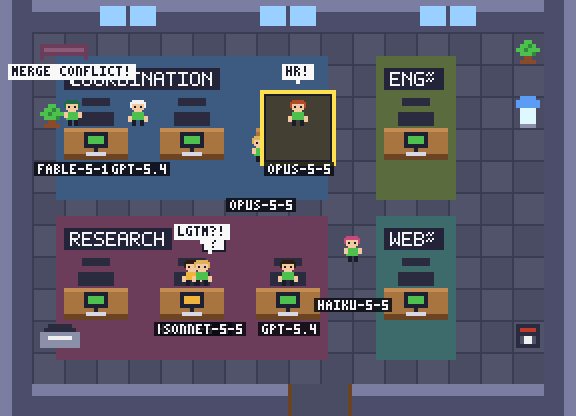
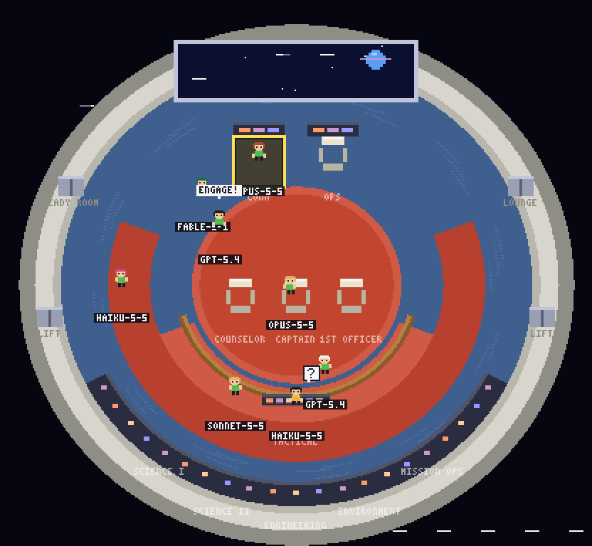
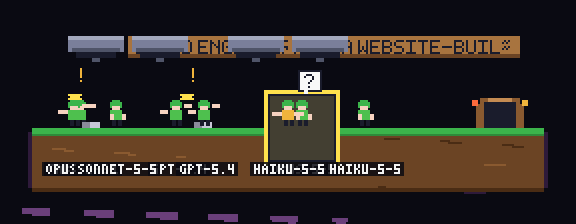
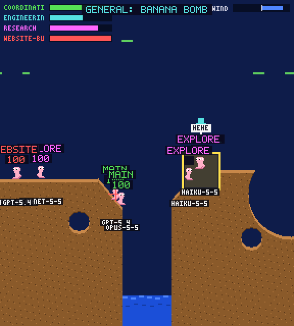

# Agentic Office

**Watch your AI agents work, wander, squabble and blow things up, live in a
pixel-art side panel.** Agentic Office turns Claude Code and GitHub Copilot
activity into a retro scene: one worker per agent, with its model name, moving
through an 8-bit office, a starship bridge, a platform-critters level, or a
battle arena on destructible terrain. Everything runs locally from Claude's
hooks and Copilot's session logs; nothing leaves your machine.

| 8-bit office | Starship bridge |
| --- | --- |
|  |  |

| Platform critters | Battle |
| --- | --- |
|  |  |

It is a dependency-free extension that runs **alongside** Claude for VS Code, not inside
Claude's chat panel, and uses Claude's command hooks rather than private extension APIs.

## Install

1. Install Node.js 18+ where Claude Code runs and use VS Code 1.85+.
2. Build the package from this repository:

   ```
   npm run package
   ```

   This produces `agentic-office-<version>.vsix` (no dependencies to install;
   the packaging tool is fetched on demand).
3. Install it with **Extensions: Install from VSIX** in VS Code, or from a terminal:

   ```
   code --install-extension agentic-office-0.1.0.vsix
   ```

   Use `code-insiders` for VS Code Insiders.
4. Open the trusted workspace where you use Claude Code and run
   **Agentic Office: Open Office** from the Command Palette.
5. Click **Install Claude hooks** (or run **Agentic Office: Install Claude Code Hooks**).
   Choose a folder if using a multi-root workspace, and approve the local settings change.
6. Restart Claude Code or start a new session to load hooks. Submit a prompt or
   launch subagents; they appear as events arrive. Copilot CLI sessions need no setup.

To hack on it instead, open this repository in VS Code and press **F5** to launch
the extension development host.

If `node` is not on Claude's PATH, set `agenticOffice.nodePath` to its executable's
absolute path before installing hooks. This is a machine-scoped setting. For SSH,
WSL, or containers, install/run the extension and Node on that workspace host.
Windows hook commands target Claude Code's Git Bash shell, not CMD or PowerShell.
The office polls local activity every 750 ms; it does not require a server or port.

## Office and inspector

- **Themes.** The theme selector in the panel header switches between four
  live scenes, saved to the `agenticOffice.theme` user setting:
  - **8-bit office**: one open-plan floor with a desk pod per department, floor
    signs, plants, a water cooler, printer, coffee machine and sofa. Workers
    wander between desks, shout office nonsense in speech bubbles, and attack
    each other with staplers, keyboards, mugs, swivel chairs, monitors and
    rubber bands. Victims stagger, flash and complain. New agents fade in; a
    finished agent leaves in a puff of smoke with "HOME TIME!".
  - **Starship bridge**: a classic starship bridge seen from above: main viewer up
    front with CONN and OPS below it, the captain's chair flanked by the first
    officer and counselor on the red command platform, a horseshoe railing with
    tactical behind them, the curved science and engineering console bank aft,
    turbolifts, ready room and lounge doors. Main sessions take the command
    chairs; subagents fill the stations in order and overflow to standing
    positions. Crew **beam in** with a transporter sparkle on start and beam out
    on finish, wander the deck, and now and then draw a phaser on a colleague
    for no reason while shouting for the Empire.
  - **Platform critters**: a single ledge spanning the map with one entrance
    hatch and sign per department along the top and one exit door at the right.
    Green-haired critters walk the whole level end to end and scuffle when they
    bump into each other. A finished agent says "OH NO!" and pops.
  - **Battle**: a destructible-terrain battle (see below).
- **Only active agents are drawn.** Agents that are working or waiting have a
  place on the map; idle and finished agents are left out so the map stays
  readable. When nothing is active the map says so.
- **Resizing never resets the action.** Positions scale with the map, so
  dragging the panel wider or narrower keeps fights, walks and turns going.
- **Model tags.** Each worker carries a small label with the model running under
  it (for example `fable-5-1` or `gpt-5.4`) as soon as it is known.
- Each agent is keyed by session and agent ID, so parallel agents of the same
  type remain separate. Click a worker (or Tab to it and press Enter) to open
  the inspector with status, model, provider, prompt preview, last tool, IDs,
  workspace and last activity. Click empty map space or press Escape to close it.
- Main sessions form **Coordination**; subagent types form their own
  departments. Map agent types to departments using the `agenticOffice.departments`
  setting (for example, map `Explore` to `Research`). Changes apply immediately.
- Waiting agents show a blinking `?`. Reduced-motion settings freeze all scenes.

## Battle theme

The Battle map is a live, physics-driven arena. Two continents of destructible
terrain face each other across a narrow channel with a very small sea at the
bottom; the land runs to the bottom of the map and nobody can enter the channel,
so no agent ever drowns. Each department is a team with its own color, shown
with a health bar in the top-left corner.

- **New agents parachute in** from the top of the map, drifting with the wind,
  and land wherever the terrain catches them.
- **Fighters move on their own**: they wander, climb small slopes, hop, and fall
  into the craters that weapons have dug.
- **Teams take turns** firing at rival teams with a random weapon: bazooka
  (wind-affected), grenade, shotgun, holy hand grenade, air strike, super sheep,
  **mad cow** (thrown in an arc, then charges along the ground until it goes
  off with a "MOOOO!"), dynamite, or banana bomb. Every blast eats a hole out of
  the map, and that damage survives resizes, so a long session leaves the
  landscape in ruins. Hits knock fighters flying, deduct health, and leave floating
  damage numbers and quips. A fighter that reaches zero health is blown up, leaves
  a gravestone, and respawns by parachute as reinforcements.
- **A finished agent's fighter explodes** and leaves a gravestone with its name.
- Health, craters and gravestones are cosmetic; the real agent status still
  comes from hooks. Only working agents move and fire. Waiting agents stand
  still holding a `?`.

## GitHub Copilot sessions

Copilot CLI writes an event log for every session to
`~/.copilot/session-state/<id>/events.jsonl` (or `$COPILOT_HOME/session-state`).
That includes the agent sessions VS Code's Copilot Chat runs through the CLI.
The extension tails logs modified in the last 12 hours whose working directory
is inside an open workspace folder and shows them alongside Claude agents, with
the model name Copilot reports. No hooks are needed. Session start, model
changes, prompts, tool calls, subagent starts, final answers, and shutdown are
mapped onto the same statuses as the Claude hooks below. Copilot Chat's
in-editor agent mode without the CLI does not write this log and is not shown.
Disable with the `agenticOffice.copilotSessions` setting.

## Hook contract and limits

| Event | Interpretation |
| --- | --- |
| `SessionStart` | Main session is idle |
| `UserPromptSubmit` | Main session is working; captures `prompt` preview |
| `SubagentStart` | Agent identified by `agent_id`/`agent_type` is working |
| `PreToolUse`, `PostToolUse`, `PostToolUseFailure` | Agent is working; records `tool_name` |
| `PermissionRequest` | Agent is waiting |
| `Notification` | `permission_prompt` or `idle_prompt` means main session is waiting |
| `Stop` | Main session is idle (a completed turn is not an ended session) |
| `SubagentStop` | Subagent is finished |
| `SessionEnd` | All agents belonging to the session are finished |

Inputs use `hook_event_name`, `session_id`, and optional `cwd`. The model name
comes from `model` on `SessionStart` when Claude supplies it; otherwise the bridge
reads the **last 64 KiB** of the session transcript (or the subagent transcript
for events carrying `agent_id`) and keeps only the latest `model` value. Tool events use
`agent_id` and `agent_type` **when supplied**; without `agent_id` they update the
main session. A main session may have an `agent_type` without being a subagent.
Lifecycle hooks identify subagents but do **not** provide their assigned prompt;
the inspector explicitly shows that limitation instead of guessing or reading transcripts.

Verified against the [official Anthropic SDK hook input definitions](https://github.com/anthropics/claude-agent-sdk-python/blob/b6e9d12fe1cc98dde988ab7b7713c1feeee50c6c/src/claude_agent_sdk/types.py)
and [official SDK changelog](https://github.com/anthropics/claude-agent-sdk-typescript/blob/85d8f8e0772199ec7965a0c2e874ac88343f2a01/CHANGELOG.md).
The changelog records a VS Code `PermissionRequest` fix in Claude Code 2.1.21
and tool-event agent attribution in SDK 0.2.69. Use a recent Claude Code version:
older builds can omit attribution. The SDK source does not provide complete
`SessionStart`/`SessionEnd` input definitions; this extension only consumes their
common envelope, not unverified event-specific fields.
See the [Claude Code hooks reference](https://code.claude.com/docs/en/hooks)
for your installed version's settings and support.

Status is an **inference from the last observed hook**, not a live heartbeat.
Closing/crashing Claude without a final hook, rejecting permissions, disabling
hooks, or missing version-specific events can leave stale dots. Long-running work
between hooks stays working. Historical activity is replayed when the extension
starts, so the last-activity timestamp matters. At most 200 agents are displayed;
finished agents are evicted first when that limit is reached. Only the most recent
1 MiB of an event backlog is replayed. This can omit older starts/tasks.

## Settings, privacy, and removal

Installation merges hooks into `.claude/settings.local.json`, preserves unrelated
settings/hooks, and creates a uniquely named sibling backup before changing an
existing file. Reinstalling replaces this extension's hooks without duplicating
them. Invalid JSON/settings are rejected without overwriting them. Hooks disabled
by higher-priority Claude settings or organizational policy must be enabled separately.

The standalone bridge is copied into VS Code extension global storage, in a
workspace-specific directory with an `events.jsonl` file. Hook commands contain
these absolute paths, remain valid across extension upgrades, and must be
reinstalled if you move the workspace or switch VS Code profiles.
The bridge emits no hook decisions or stdout and fails open; visualization errors
must not interrupt Claude. Payloads larger than 1 MiB are ignored.

Only IDs, agent type, model name, workspace path, event name, last tool name,
notification type, timestamp, and **up to 500 characters of your prompt** are
persisted. Tool inputs, outputs, credentials, and transcript text are not
collected (the transcript is opened only to read the model name); prompts may nevertheless
contain sensitive information. Install only if you accept local prompt storage.
Files/directories created for activity use owner-only permissions on POSIX;
Windows uses the storage directory's inherited ACLs. No activity is sent over a network.
Webview content uses text-only rendering and a restrictive content security policy.

To uninstall the integration, remove only command hooks containing
`--agentic-office --output` from `.claude/settings.local.json` (or restore a backup
if no newer settings need preserving), then restart Claude. Disabling/uninstalling
the extension alone does not remove installed hooks. Delete the workspace's
`events.jsonl` at the path in those commands to clear saved history; close the
office/extension first. Logs are append-only and are **not automatically deleted**;
remove them periodically for retention/disk usage. Backup settings can also contain
private values and should not be committed.

## Development

- `npm test`: Node's built-in tests for agent state, hook merging/quoting, the bridge/reader,
  model extraction, and the Copilot session translator.
- `npm run check`: syntax checks for all production JavaScript.
- F5: manually test the extension host, hook installation, and webview interactions.

No runtime or development dependencies are required.